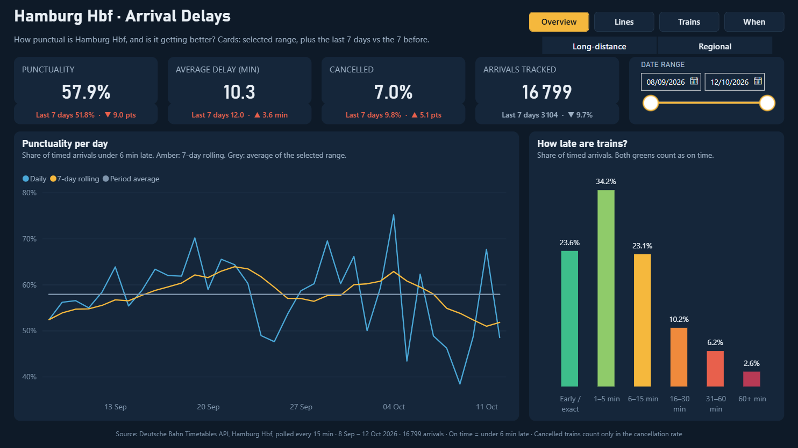
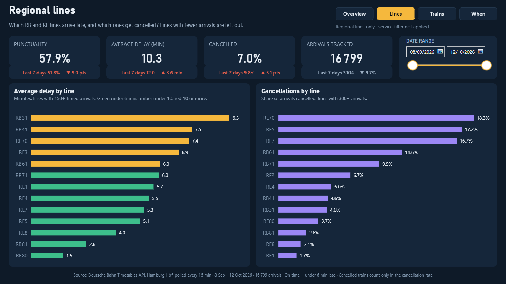
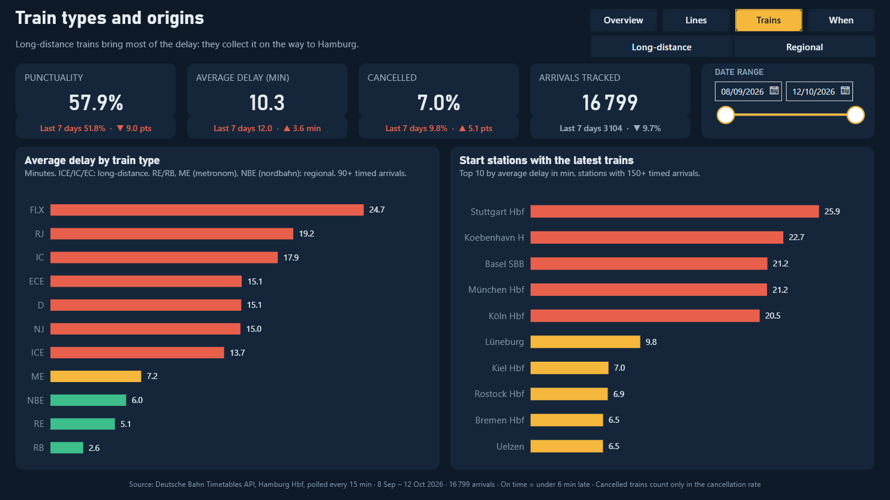
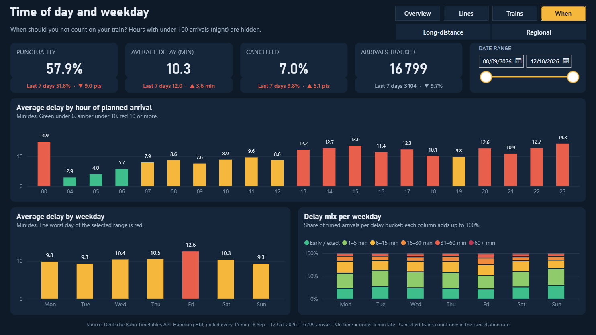
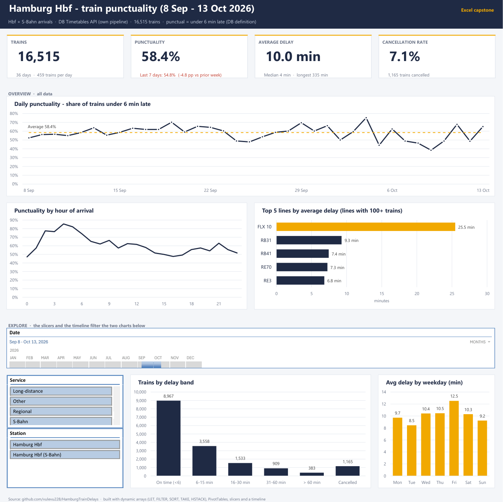

# 🚂 Hamburg Hbf Train Delays

> **A self-running data pipeline and Power BI dashboard on train punctuality at Hamburg Hauptbahnhof.**

## 📊 Project Overview
Every 15 minutes my own collector on a Raspberry Pi polls the Deutsche Bahn Timetables API for
Hamburg Hbf (main hall: long-distance + regional trains) and, since 13 Oct 2026,
the underground S-Bahn platforms (S1/S3/S5/S7). It joins the **planned timetable**
against the **live change feed** and upserts one row per train into a growing
dataset (`hamburg_delays.csv`), which feeds a four-page Power BI report.

> **Data collection: my own Raspberry Pi.** Since 28 Oct 2026 the data is extracted by my own
> collector running 24/7 on a Raspberry Pi 4 at home (systemd timer, `pi/`). It polls the official
> DB API and commits the dataset to this repo; GitHub Actions stays on as a backup.

## 📈 Dashboard
Data window: 8 Sep – 12 Oct 2026, 16,799 arrivals (before the S-Bahn was added).
"On time" follows Deutsche Bahn's own rule: less than 6 minutes late.


*Overview: 57.9% of arrivals on time, average delay 10.3 min, 7.0% cancelled. Each KPI compares the last 7 days with the 7 before.*


*Regional lines: RE80 is the most punctual (1.5 min on average), RB31 the least (9.3 min); RE70 lost 18.3% of its arrivals to cancellations.*


*Train types and origins: long-distance trains bring the delay with them (FlixTrain 24.7 min, ICE 13.7 min, RB 2.6 min); trains from Stuttgart arrive 25.9 min late on average.*


*When: delays build up from early afternoon until midnight; Friday is the worst day (12.6 min).*

## 📗 Excel version
The same data rebuilt in Excel ([`excel/Hamburg_Delays_Capstone.xlsx`](excel/Hamburg_Delays_Capstone.xlsx)):
16,515 Hbf + S-Bahn arrivals from 8 Sep – 13 Oct 2026, a snapshot of `hamburg_delays.csv`.


*58.4% of arrivals on time, but only 54.8% in the last 7 days (−4.8 pp vs the week before). FlixTrain FLX 10 is the most delayed line (25.5 min on average).*

* **Calculated table columns:** date/hour/weekday, a "late" flag following DB's 6-minute rule, delay bands, service type
* **Dynamic arrays:** `LET`, `FILTER`, `SORT`/`SORTBY`, `UNIQUE`, `TAKE`, `HSTACK`, `SEQUENCE`, `XLOOKUP`
  for KPIs, group tables and Top-N lists
* **Interactive line report:** a dropdown picks a line and every figure for that line updates
* **PivotTables:** sharing one slicer set (service, station) and a date timeline
* **Dashboard sheet:** KPI cards linked to the formulas, plus formula charts and PivotCharts

Each task sheet checks its answers against a hidden answer key, because the workbook doubled as an Excel training project.

### 🗺️ Roadmap
* **S-Bahn** – collecting since 13 Oct 2026 (station `Hamburg Hbf (S-Bahn)`, EVA 8098549).
* **U-Bahn** – access to the HOCHBAHN / hvv GTI interface has been requested.

---

## 🛠️ The Tech Stack
* **Python + `requests`:** Polls two Timetables API endpoints and merges them.
* **pandas:** Parses the API's timestamp format, computes delays, de-duplicates.
* **matplotlib:** Quick hourly delay chart from `scripts/analyze_delays.py` (not committed).
* **Raspberry Pi 4 (systemd) + GitHub Actions:** Run the collector every 15 min and push the CSV
  (the Pi is the main runner since 28 Oct 2026; before that a Windows Task Scheduler job on my laptop).
* **Power BI (Power Query, DAX):** Four-page report with a date table, 37 measures and
  "last 7 days vs the 7 before" comparisons on every KPI.
* **Excel (dynamic arrays, PivotTables, slicers):** The same analysis as a formula-driven workbook with a dashboard sheet.

---

## 🗂️ Dataset schema (`hamburg_delays.csv`)
| column | meaning |
|---|---|
| `check_time` | when the poll that produced this row ran |
| `train_id` | DB stop id (unique per train run — the upsert key) |
| `category` | ICE / IC / RE / RB / ME … |
| `line` | line label (RE8, RB81, …) |
| `train_no` | train number |
| `planned_arr` | scheduled arrival at Hamburg Hbf |
| `actual_arr` | current/estimated arrival (equals `planned_arr` when nothing changed) |
| `delay_min` | `actual_arr − planned_arr` in minutes (blank if planned time unknown) |
| `cancelled` | 1 if the stop was cancelled |
| `platform` | arrival platform |
| `origin` | first station on the train's route |
| `source` | `live` (current pipeline) or `legacy` (migrated May/Aug capture) |
| `station` | `Hamburg Hbf` (EVA 8002549) or `Hamburg Hbf (S-Bahn)` (EVA 8098549, from 13 Oct 2026) |

---

## 🔍 Engineering Challenges & Solutions

### 1. The change feed has no planned times
* **Challenge:** `/fchg` returns *changes only* — a current arrival estimate
  (`ct`) but almost never the original planned time (`pt`). On its own ~88% of
  rows can't produce a delay figure.
* **Solution:** also pull `/plan/{eva}/{date}/{hour}` for the previous, current
  and next hour and join on the stop id. A train first seen outside that window
  with no planned time is back-filled automatically on a later run (the upsert
  keys on `train_id`).

### 2. The "Zombie Train" problem (data latency)
* **Challenge:** the API occasionally echoes stale records — trains from 12+
  hours ago that never cleared the system.
* **Solution:** `analyze_delays.py` compares each record's `check_time` against
  its `planned_arr` and drops anything more than 12 h apart before averaging.

### 3. Integer-to-datetime transformation
* **Challenge:** the API returns timestamps as `YYMMDDHHMM` integers; naïve
  subtraction breaks at hour/day boundaries and some records omit the planned time.
* **Solution:** `pandas.to_datetime(..., format='%y%m%d%H%M', errors='coerce')`
  parses into real datetimes; rows that fail to parse are dropped, not crashed on.

### 4. Excel corrupted an earlier capture
* **Challenge:** an early `hamburg_delays.csv` was round-tripped through Excel,
  which coerced ~48% of the train ids into floats like `-8.4E+18` and rewrote the
  dates as `DD/MM/YYYY`.
* **Solution:** `scripts/clean_merge.py` drops the unrecoverable ids, normalises
  both timestamp styles, collapses each capture to one row per train, tags it
  `source=legacy`, and merges it under the live data.

### 5. Merge conflicts on every single line
* **Challenge:** with the collector running on both Windows (Task Scheduler) and
  Linux (GitHub Actions), every pull conflicted on every line of the CSV.
* **Solution:** two causes. Windows wrote CRLF line endings and Linux LF, so
  `.gitattributes` now forces LF. Rebasing a commit that rewrites the whole file
  can never apply cleanly, so both runners now reset to `origin/main` *before*
  collecting and simply retry the full cycle when a push is rejected.

### 6. Silently blanked planned times
* **Challenge:** the upsert replaced a train's whole row on each poll. Once a
  train left the ±1 h timetable window, later polls blanked its planned time,
  and with it the delay: only 24% of rows had one, and September looked four
  times worse than October.
* **Solution:** `merge_row()` now never blanks a known value, and a write guard
  refuses to save if any field would lose values. `scripts/backfill_history.py`
  replayed all 2,077 committed versions of the CSV to restore the lost fields:
  delay coverage went from 24% to 81%, and both months now show the same 4-minute median.

### 7. The S-Bahn was invisible
* **Challenge:** Hamburg Hbf's station id (8002549) never lists S-Bahn trains.
* **Solution:** the underground S-Bahn platforms are a separate station in the
  API (8098549). The collector polls both and records which one in `station`.

---

## ▶️ Usage

### Power BI report
Open `powerbi/hamburg_delays.pbip` in Power BI Desktop and press **Refresh**. The query reads
`hamburg_delays.csv` from `C:\Users\emira\Projects\GitHub-Projects\HamburgTrainDelays\`; if your clone
lives elsewhere, change the path in Power Query (Transform data → Delays → Source).

### One-off
```bash
# 1. Put DB_CLIENT_ID / DB_API_KEY in a local .env (git-ignored)
pip install -r requirements.txt        # requests, pandas, matplotlib, python-dotenv

# 2. Collect once (appends/updates hamburg_delays.csv)
python scripts/hamburg_collector.py

# 3. Quick text summary + matplotlib chart (writes images/chart_preview.png, git-ignored)
python scripts/analyze_delays.py

# 4. (once) migrate the legacy May/August captures into the current schema
python scripts/clean_merge.py
```

### Run it on a schedule

Three options — running more than one is fine (each run re-syncs from `origin` before
pushing, so they can't conflict). Mine: **C** as the main runner, **A** as a backup.

**A. GitHub Actions (cloud, works with your machine off)** — `.github/workflows/hamburg_delays.yml`
Runs `*/15 * * * *` (GitHub throttles cron, so realistically every 15–40 min).
Needs two repo secrets: **Settings → Secrets and variables → Actions →**
`DB_CLIENT_ID`, `DB_API_KEY`. Trigger a manual run from the **Actions** tab or
`gh workflow run "Hamburg Delays Collector"`.

**B. Windows Task Scheduler (local, only while you're logged in)**
```powershell
powershell -ExecutionPolicy Bypass -File scripts\install_task.ps1
# remove:  Unregister-ScheduledTask -TaskName "HamburgDelaysCollector"
```
`collect_and_push.ps1` runs the collector, then commits and pushes
`hamburg_delays.csv` only when it changed. Activity is logged to `collector.log`.

**C. Raspberry Pi / any Linux box (24/7, what I use)** — `pi/`
```bash
# shallow clone + venv, then:
cp pi/htd_collect_and_push.sh ~/bin/ && chmod +x ~/bin/htd_collect_and_push.sh
sudo cp pi/htd-collector.service pi/htd-collector.timer /etc/systemd/system/
sudo systemctl enable --now htd-collector.timer      # every 15 min at :02, :17, :32, :47
```
`htd_collect_and_push.sh` is the bash port of `collect_and_push.ps1` (same reset → collect →
commit → push → retry cycle) and pushes with a deploy key that can write to this repo only.
`NO_PUSH=1` collects without pushing (test mode). Activity is logged to `~/hamburg-delays-collector.log`.
